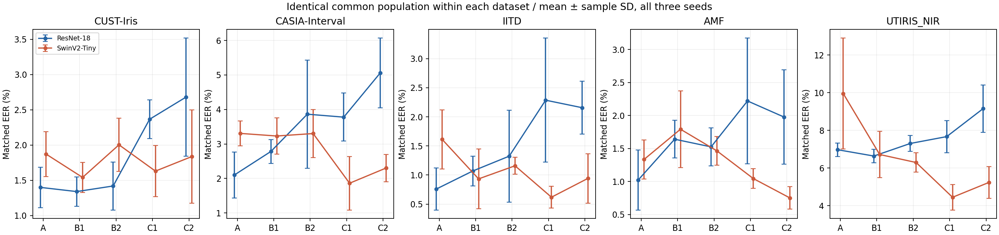

# E2-A: Matched architecture–representation verification

Publication summary of saved findings. Complete numerical records and interpretation are in [the detailed report](Results/DETAILED_REPORT.md) and [result index](Results/README.md).

All 30 validation-selected models, all five independent datasets, identical common images and exhaustive genuine/different-subject impostor pairs within each dataset.
The optional opposite-eye diagnostic stays separate. All three seeds are reported; no pooled-domain ROC or favorable-seed selection.
Saved original full-population embeddings are scored only on the published matched pairs. If recomputing inference, retain the original full inference order and batch size before filtering.

## Population

| dataset | images | subjects | iris_ids | genuine | impostor | opposite_eye_diagnostic |
| --- | --- | --- | --- | --- | --- | --- |
| AMF | 523 | 54 | 108 | 1015 | 134214 | 1274 |
| UTIRIS_NIR | 770 | 79 | 158 | 1544 | 292613 | 1908 |
| CUST-Iris | 427 | 54 | 108 | 634 | 89473 | 844 |
| CASIA-Interval | 395 | 37 | 59 | 1353 | 75272 | 1190 |
| IITD | 308 | 32 | 63 | 628 | 45936 | 714 |

## Numerical overview

EER (%), mean ± sample SD across all three seeds. Individual results and all four metrics are retained in the tables.

| Model | Input | CUST-Iris | CASIA-Interval | IITD | AMF | UTIRIS_NIR |
| --- | --- | --- | --- | --- | --- | --- |
| ResNet-18 | E1-A | 1.400 ± 0.287 | 2.101 ± 0.667 | 0.760 ± 0.360 | 1.024 ± 0.454 | 6.973 ± 0.357 |
| ResNet-18 | E1-B1 | 1.341 ± 0.209 | 2.782 ± 0.346 | 1.069 ± 0.254 | 1.642 ± 0.284 | 6.636 ± 0.349 |
| ResNet-18 | E1-B2 | 1.420 ± 0.340 | 3.863 ± 1.566 | 1.324 ± 0.788 | 1.526 ± 0.290 | 7.303 ± 0.418 |
| ResNet-18 | E1-C1 | 2.366 ± 0.273 | 3.778 ± 0.696 | 2.286 ± 1.066 | 2.222 ± 0.952 | 7.668 ± 0.853 |
| ResNet-18 | E1-C2 | 2.680 ± 0.836 | 5.057 ± 1.013 | 2.157 ± 0.455 | 1.978 ± 0.714 | 9.155 ± 1.259 |
| SwinV2-Tiny | E1-A | 1.872 ± 0.318 | 3.306 ± 0.357 | 1.612 ± 0.507 | 1.336 ± 0.294 | 9.956 ± 2.944 |
| SwinV2-Tiny | E1-B1 | 1.541 ± 0.214 | 3.231 ± 0.527 | 0.934 ± 0.515 | 1.793 ± 0.580 | 6.717 ± 1.233 |
| SwinV2-Tiny | E1-B2 | 2.004 ± 0.378 | 3.302 ± 0.693 | 1.159 ± 0.144 | 1.465 ± 0.218 | 6.292 ± 0.518 |
| SwinV2-Tiny | E1-C1 | 1.631 ± 0.363 | 1.861 ± 0.775 | 0.619 ± 0.186 | 1.046 ± 0.149 | 4.445 ± 0.674 |
| SwinV2-Tiny | E1-C2 | 1.838 ± 0.661 | 2.301 ± 0.397 | 0.942 ± 0.423 | 0.753 ± 0.169 | 5.235 ± 0.850 |

## Figure

This display is rendered from the unchanged recorded tables. Its complete plotting code is in the standalone notebook.

## Reproduce and inspect

Open [E2-A.ipynb](E2-A.ipynb); configure direct external assets and enable `RUN_ANALYSIS`. No preceding notebook is required. [METHOD.md](METHOD.md) states exact definitions and interpretation limits. New outputs never overwrite recorded results.
