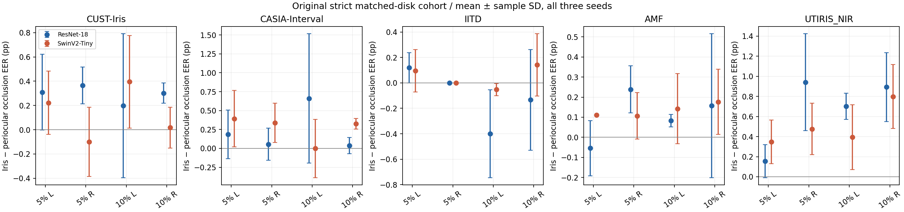

# E2-D: Matched-area iris/periocular partial occlusion

Publication summary of saved findings. Complete numerical records and interpretation are in [the detailed report](Results/DETAILED_REPORT.md) and [result index](Results/README.md).

Original E1-A models only. Equal-shape/equal-area disks replace pixels with the frozen training mean at 5% and 10% of segmented annulus area, on image-coordinate left/right sides.
Both paired disks share center y; all eight variants must fit completely inside their respective guarded ROIs. No relaxed placement or fallback.
This analysis has its original **matched feasible-occlusion cohort**, shared across its baseline and every variant, distinct from the all-five-representation common cohort. Frozen membership/pairs are provided directly; no other notebook must run.
Different texture energy, spatial position, segmentation and feasibility selection limit interpretation.

## Population

| dataset | original_images | eligible_images | unavailable_images | subjects | iris_ids | genuine | impostor | opposite_eye_diagnostic |
| --- | --- | --- | --- | --- | --- | --- | --- | --- |
| CUST-Iris | 432 | 398 | 34 | 53 | 106 | 572 | 77670 | 761 |
| CASIA-Interval | 396 | 147 | 249 | 29 | 45 | 260 | 10226 | 245 |
| IITD | 319 | 151 | 168 | 28 | 43 | 236 | 10911 | 178 |
| AMF | 524 | 479 | 45 | 52 | 104 | 906 | 112442 | 1133 |
| UTIRIS_NIR | 793 | 542 | 251 | 78 | 147 | 873 | 144715 | 1023 |

## Numerical overview

Paired iris-occluded minus periocular-occluded EER; all original area/side conditions are kept.

| dataset | architecture | area_fraction | side | EER change (pp) |
| --- | --- | --- | --- | --- |
| AMF | ResNet-18 | 0.05 | left | -0.054 ± 0.137 |
| AMF | ResNet-18 | 0.05 | right | 0.239 ± 0.117 |
| AMF | ResNet-18 | 0.1 | left | 0.083 ± 0.031 |
| AMF | ResNet-18 | 0.1 | right | 0.157 ± 0.358 |
| AMF | SwinV2-Tiny | 0.05 | left | 0.110 ± 0.000 |
| AMF | SwinV2-Tiny | 0.05 | right | 0.107 ± 0.116 |
| AMF | SwinV2-Tiny | 0.1 | left | 0.142 ± 0.175 |
| AMF | SwinV2-Tiny | 0.1 | right | 0.176 ± 0.162 |
| CASIA-Interval | ResNet-18 | 0.05 | left | 0.185 ± 0.320 |
| CASIA-Interval | ResNet-18 | 0.05 | right | 0.054 ± 0.213 |
| CASIA-Interval | ResNet-18 | 0.1 | left | 0.661 ± 0.854 |
| CASIA-Interval | ResNet-18 | 0.1 | right | 0.036 ± 0.107 |
| CASIA-Interval | SwinV2-Tiny | 0.05 | left | 0.392 ± 0.373 |
| CASIA-Interval | SwinV2-Tiny | 0.05 | right | 0.338 ± 0.259 |
| CASIA-Interval | SwinV2-Tiny | 0.1 | left | -0.001 ± 0.386 |
| CASIA-Interval | SwinV2-Tiny | 0.1 | right | 0.324 ± 0.070 |
| CUST-Iris | ResNet-18 | 0.05 | left | 0.310 ± 0.311 |
| CUST-Iris | ResNet-18 | 0.05 | right | 0.365 ± 0.152 |
| CUST-Iris | ResNet-18 | 0.1 | left | 0.197 ± 0.593 |
| CUST-Iris | ResNet-18 | 0.1 | right | 0.302 ± 0.082 |
| CUST-Iris | SwinV2-Tiny | 0.05 | left | 0.222 ± 0.260 |
| CUST-Iris | SwinV2-Tiny | 0.05 | right | -0.100 ± 0.286 |
| CUST-Iris | SwinV2-Tiny | 0.1 | left | 0.395 ± 0.382 |
| CUST-Iris | SwinV2-Tiny | 0.1 | right | 0.018 ± 0.168 |
| IITD | ResNet-18 | 0.05 | left | 0.119 ± 0.119 |
| IITD | ResNet-18 | 0.05 | right | -0.001 ± 0.001 |
| IITD | ResNet-18 | 0.1 | left | -0.399 ± 0.346 |
| IITD | ResNet-18 | 0.1 | right | -0.133 ± 0.395 |
| IITD | SwinV2-Tiny | 0.05 | left | 0.096 ± 0.167 |
| IITD | SwinV2-Tiny | 0.05 | right | 0.000 ± 0.000 |
| IITD | SwinV2-Tiny | 0.1 | left | -0.053 ± 0.048 |
| IITD | SwinV2-Tiny | 0.1 | right | 0.141 ± 0.245 |
| UTIRIS_NIR | ResNet-18 | 0.05 | left | 0.155 ± 0.164 |
| UTIRIS_NIR | ResNet-18 | 0.05 | right | 0.941 ± 0.483 |
| UTIRIS_NIR | ResNet-18 | 0.1 | left | 0.702 ± 0.130 |
| UTIRIS_NIR | ResNet-18 | 0.1 | right | 0.893 ± 0.343 |
| UTIRIS_NIR | SwinV2-Tiny | 0.05 | left | 0.348 ± 0.217 |
| UTIRIS_NIR | SwinV2-Tiny | 0.05 | right | 0.476 ± 0.256 |
| UTIRIS_NIR | SwinV2-Tiny | 0.1 | left | 0.393 ± 0.322 |
| UTIRIS_NIR | SwinV2-Tiny | 0.1 | right | 0.799 ± 0.318 |

## Figure

This display is rendered from the unchanged recorded tables. Its complete plotting code is in the standalone notebook.

## Reproduce and inspect

Open [E2-D.ipynb](E2-D.ipynb); configure direct external assets and enable `RUN_ANALYSIS`. No preceding notebook is required. [METHOD.md](METHOD.md) states exact definitions and interpretation limits. New outputs never overwrite recorded results.
