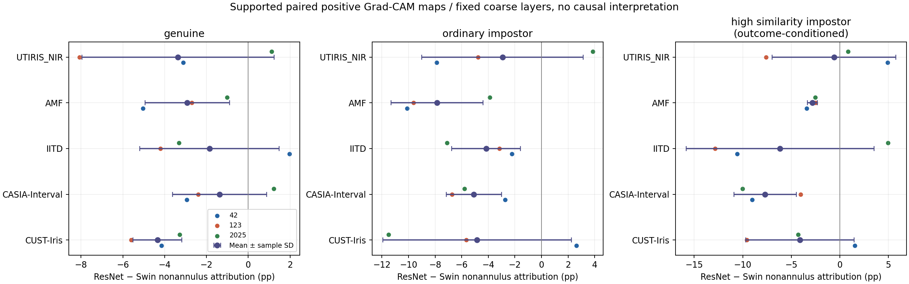

# E2-F: Pair-conditioned Grad-CAM

Publication summary of saved findings. Complete numerical records and interpretation are in [the detailed report](Results/DETAILED_REPORT.md) and [result index](Results/README.md).

The fixed selection contains 12 genuine, 12 ordinary-impostor and six high-similarity-impostor pairs per dataset, shared by all six original raw checkpoints.
High-similarity selection uses mean average-tie impostor percentile across the six models and is explicitly outcome-conditioned. Selection is fixed before maps and supplied directly as data; optional exact reconstruction code is included.
Pair cosine is differentiated through both inputs of one shared encoder in FP32. ResNet layer4 and Swin final normalization both yield native 10×10 spatial grids.
Positive Grad-CAM is L1-normalized over nonpadding content. Nonannulus includes pupil and outside-disc regions. Parameter-randomization and fixed-anchor partner controls remain in memory only.
The original saved-AMP agreement tolerance stays 0.001. The 30 unsupported primary branch maps remain disclosed and excluded from supported paired summaries; numerical replay never rescues them.
Grad-CAM does not establish causal identity reliance. Private biometric galleries can be regenerated locally but are not redistributed.

## Numerical overview

ResNet−Swin nonannulus positive-attribution mass (percentage points). Negative values indicate more nonannulus mass for Swin under the fixed target/layer/support policy; this is not a causal identity-cue finding.

| dataset | category | mean_resnet_minus_swin_nonannulus_pp | sample_sd_pp | seed42_pp | seed123_pp | seed2025_pp |
| --- | --- | --- | --- | --- | --- | --- |
| AMF | genuine | -2.9162 | 2.0167 | -5.0308 | -2.7035 | -1.0143 |
| AMF | high_similarity_impostor | -2.8188 | 0.516 | -3.414 | -2.4964 | -2.5461 |
| AMF | ordinary_impostor | -7.8612 | 3.4595 | -10.0949 | -9.6123 | -3.8762 |
| CASIA-Interval | genuine | -1.372 | 2.2559 | -2.9384 | -2.3913 | 1.2137 |
| CASIA-Interval | high_similarity_impostor | -7.7035 | 3.2154 | -9.0372 | -4.0358 | -10.0374 |
| CASIA-Interval | ordinary_impostor | -5.0833 | 2.0789 | -2.7451 | -6.7228 | -5.782 |
| CUST-Iris | genuine | -4.3421 | 1.1709 | -4.1432 | -5.5997 | -3.2835 |
| CUST-Iris | high_similarity_impostor | -4.113 | 5.5701 | 1.5421 | -9.5939 | -4.2872 |
| CUST-Iris | ordinary_impostor | -4.8408 | 7.0984 | 2.6252 | -5.6445 | -11.5032 |
| IITD | genuine | -1.8508 | 3.3321 | 1.9638 | -4.1931 | -3.3231 |
| IITD | high_similarity_impostor | -6.1561 | 9.6838 | -10.5619 | -12.8536 | 4.9473 |
| IITD | ordinary_impostor | -4.1634 | 2.5863 | -2.2279 | -3.1617 | -7.1008 |
| UTIRIS_NIR | genuine | -3.3613 | 4.5992 | -3.1174 | -8.0776 | 1.1111 |
| UTIRIS_NIR | high_similarity_impostor | -0.6019 | 6.3838 | 4.9291 | -7.5874 | 0.8527 |
| UTIRIS_NIR | ordinary_impostor | -2.9301 | 6.0737 | -7.8728 | -4.7676 | 3.8502 |

Primary coverage is **1,770 supported of 1,800 branch maps**, and **870 of 900 matched architecture branch comparisons**. The 30 primary unsupported maps remain disclosed. All 3,060 primary/control/partner branch-map statistics remain saved. The [numerical diagnostic report](Results/NUMERICAL_DIAGNOSTIC_REPORT.md) preserves the unchanged tolerance and exact original-batch replay evidence.

See [sanity checks](Results/E2_F_SANITY_CHECKS.md) and [final interpretation](Results/E2_F_FINAL_INTERPRETATION.md) for parameter-randomization, partner controls, seed reversals and limitations.

## Figure

This display is rendered from the unchanged recorded tables. Its complete plotting code is in the standalone notebook.

## Reproduce and inspect

Open [E2-F.ipynb](E2-F.ipynb); configure direct external assets and enable `RUN_ANALYSIS`. No preceding notebook is required. [METHOD.md](METHOD.md) states exact definitions and interpretation limits. New outputs never overwrite recorded results.
