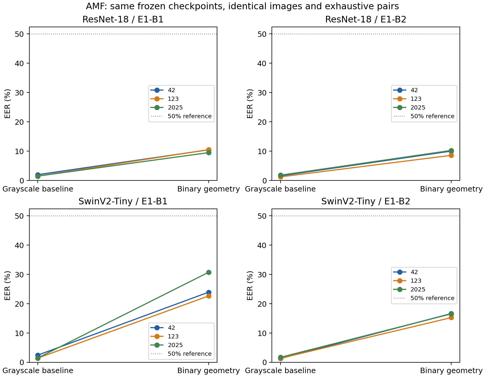
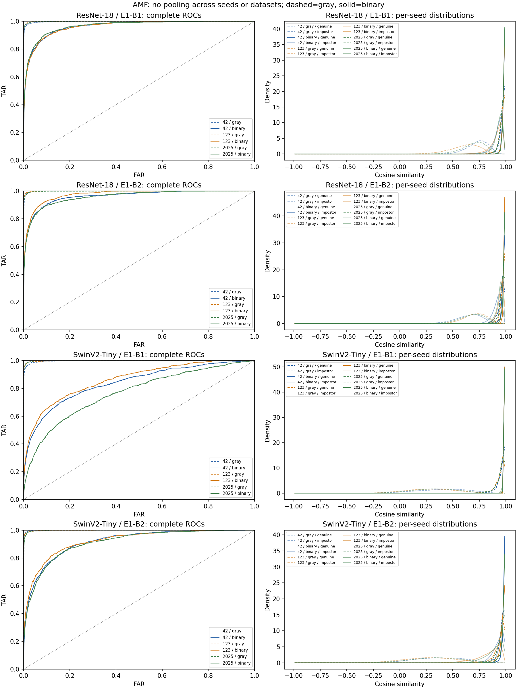

# AMF: E2-G

## Absolute metrics

EER/TAR are percent, AUC [0,1]; mean ± sample SD over the three seeds.

| dataset | architecture | condition | variant | eer | roc_auc | tar_at_far_1pct | tar_at_far_0_1pct |
| --- | --- | --- | --- | --- | --- | --- | --- |
| AMF | ResNet-18 | E1-B1 | binary_geometry | 10.1434 ± 0.5737 | 0.9643 ± 0.0015 | 59.2447 ± 1.3304 | 30.4105 ± 1.5146 |
| AMF | ResNet-18 | E1-B1 | segmented_grayscale | 1.6420 ± 0.2844 | 0.9988 ± 0.0005 | 97.7340 ± 0.6897 | 91.3957 ± 2.9905 |
| AMF | ResNet-18 | E1-B2 | binary_geometry | 9.6085 ± 0.9056 | 0.9652 ± 0.0080 | 63.6782 ± 1.3120 | 36.0920 ± 2.1949 |
| AMF | ResNet-18 | E1-B2 | segmented_grayscale | 1.5258 ± 0.2902 | 0.9989 ± 0.0005 | 97.7997 ± 0.7127 | 91.0016 ± 3.8314 |
| AMF | SwinV2-Tiny | E1-B1 | binary_geometry | 25.7800 ± 4.3421 | 0.8233 ± 0.0504 | 25.2874 ± 8.9054 | 10.3847 ± 4.4209 |
| AMF | SwinV2-Tiny | E1-B1 | segmented_grayscale | 1.7932 ± 0.5804 | 0.9984 ± 0.0008 | 96.9458 ± 1.2883 | 90.2791 ± 2.1230 |
| AMF | SwinV2-Tiny | E1-B2 | binary_geometry | 16.1576 ± 0.7695 | 0.9175 ± 0.0055 | 37.7668 ± 3.6524 | 16.9458 ± 2.5898 |
| AMF | SwinV2-Tiny | E1-B2 | segmented_grayscale | 1.4651 ± 0.2180 | 0.9989 ± 0.0005 | 97.8325 ± 0.9398 | 89.6880 ± 5.7451 |

## Paired within-checkpoint differences

EER/TAR differences are percentage points; AUC differences are on [0,1].

| dataset | architecture | condition | variant | eer | roc_auc | tar_at_far_1pct | tar_at_far_0_1pct |
| --- | --- | --- | --- | --- | --- | --- | --- |
| AMF | ResNet-18 | E1-B1 | binary-minus-grayscale | 8.5013 ± 0.5121 | -0.0345 ± 0.0016 | -38.4893 ± 1.3945 | -60.9852 ± 1.7761 |
| AMF | ResNet-18 | E1-B2 | binary-minus-grayscale | 8.0827 ± 0.6280 | -0.0337 ± 0.0076 | -34.1215 ± 1.2397 | -54.9097 ± 2.3652 |
| AMF | SwinV2-Tiny | E1-B1 | binary-minus-grayscale | 23.9868 ± 4.5695 | -0.1751 ± 0.0508 | -71.6585 ± 9.6130 | -79.8944 ± 4.5756 |
| AMF | SwinV2-Tiny | E1-B2 | binary-minus-grayscale | 14.6925 ± 0.7387 | -0.0814 ± 0.0053 | -60.0657 ± 3.2592 | -72.7422 ± 7.1061 |

## All individual seeds

| architecture | condition | seed | variant | eer | roc_auc | tar_at_far_1pct | tar_at_far_0_1pct |
| --- | --- | --- | --- | --- | --- | --- | --- |
| ResNet-18 | E1-B1 | 42 | segmented_grayscale | 1.97044 | 0.99814 | 96.94581 | 88.17734 |
| ResNet-18 | E1-B1 | 42 | binary_geometry | 10.44335 | 0.96383 | 59.21182 | 28.66995 |
| ResNet-18 | E1-B1 | 123 | segmented_grayscale | 1.47783 | 0.99916 | 98.02956 | 94.08867 |
| ResNet-18 | E1-B1 | 123 | binary_geometry | 10.50487 | 0.96307 | 57.93103 | 31.13300 |
| ResNet-18 | E1-B1 | 2025 | segmented_grayscale | 1.47783 | 0.99897 | 98.22660 | 91.92118 |
| ResNet-18 | E1-B1 | 2025 | binary_geometry | 9.48187 | 0.96600 | 60.59113 | 31.42857 |
| ResNet-18 | E1-B2 | 42 | segmented_grayscale | 1.57635 | 0.99893 | 97.33990 | 86.89655 |
| ResNet-18 | E1-B2 | 42 | binary_geometry | 10.01162 | 0.96247 | 64.53202 | 34.67980 |
| ResNet-18 | E1-B2 | 123 | segmented_grayscale | 1.21373 | 0.99934 | 98.62069 | 94.48276 |
| ResNet-18 | E1-B2 | 123 | binary_geometry | 8.57143 | 0.97422 | 64.33498 | 38.62069 |
| ResNet-18 | E1-B2 | 2025 | segmented_grayscale | 1.78744 | 0.99837 | 97.43842 | 91.62562 |
| ResNet-18 | E1-B2 | 2025 | binary_geometry | 10.24260 | 0.95883 | 62.16749 | 34.97537 |
| SwinV2-Tiny | E1-B1 | 42 | segmented_grayscale | 2.46305 | 0.99751 | 95.46798 | 88.07882 |
| SwinV2-Tiny | E1-B1 | 42 | binary_geometry | 23.94089 | 0.84036 | 29.35961 | 11.84374 |
| SwinV2-Tiny | E1-B1 | 123 | segmented_grayscale | 1.43875 | 0.99862 | 97.53695 | 92.31527 |
| SwinV2-Tiny | E1-B1 | 123 | binary_geometry | 22.66010 | 0.86291 | 31.42857 | 13.89163 |
| SwinV2-Tiny | E1-B1 | 2025 | segmented_grayscale | 1.47783 | 0.99900 | 97.83251 | 90.44335 |
| SwinV2-Tiny | E1-B1 | 2025 | binary_geometry | 30.73892 | 0.76649 | 15.07389 | 5.41872 |
| SwinV2-Tiny | E1-B2 | 42 | segmented_grayscale | 1.30314 | 0.99941 | 98.42365 | 93.00493 |
| SwinV2-Tiny | E1-B2 | 42 | binary_geometry | 16.65025 | 0.91753 | 35.96059 | 13.99015 |
| SwinV2-Tiny | E1-B2 | 123 | segmented_grayscale | 1.37931 | 0.99892 | 98.32512 | 93.00493 |
| SwinV2-Tiny | E1-B2 | 123 | binary_geometry | 15.27094 | 0.92306 | 41.97044 | 18.81773 |
| SwinV2-Tiny | E1-B2 | 2025 | segmented_grayscale | 1.71294 | 0.99843 | 96.74877 | 83.05419 |
| SwinV2-Tiny | E1-B2 | 2025 | binary_geometry | 16.55172 | 0.91204 | 35.36946 | 18.02956 |

## Similarity-distribution changes

Values are binary minus grayscale, averaged within numerical seed, then mean/sample SD across seeds. Genuine mean and impostor p99/p99.9 distinguish score shifts from verification changes. Opposite-eye scores remain diagnostic.

| dataset | architecture | condition | pair_kind | mean_mean | mean_sample_sd | p99_mean | p99_sample_sd | p999_mean | p999_sample_sd |
| --- | --- | --- | --- | --- | --- | --- | --- | --- | --- |
| AMF | ResNet-18 | E1-B1 | genuine | 0.017608 | 0.003401 | 0.001542 | 0.000917 | 0.001358 | 0.000139 |
| AMF | ResNet-18 | E1-B1 | impostor | 0.239688 | 0.056809 | 0.093488 | 0.021228 | 0.060539 | 0.013949 |
| AMF | ResNet-18 | E1-B1 | opposite_eye_diagnostic | 0.111272 | 0.029672 | 0.036925 | 0.010875 | 0.031069 | 0.009496 |
| AMF | ResNet-18 | E1-B2 | genuine | 0.020395 | 0.002974 | 0.002896 | 0.001009 | 0.001649 | 0.001762 |
| AMF | ResNet-18 | E1-B2 | impostor | 0.257676 | 0.013675 | 0.09367 | 0.008957 | 0.061734 | 0.003541 |
| AMF | ResNet-18 | E1-B2 | opposite_eye_diagnostic | 0.121832 | 0.016229 | 0.035378 | 0.004057 | 0.02653 | 0.001989 |
| AMF | SwinV2-Tiny | E1-B1 | genuine | 0.050319 | 0.006057 | 0.004212 | 0.001274 | 0.002512 | 0.000617 |
| AMF | SwinV2-Tiny | E1-B1 | impostor | 0.657702 | 0.050144 | 0.190598 | 0.039787 | 0.112575 | 0.02545 |
| AMF | SwinV2-Tiny | E1-B1 | opposite_eye_diagnostic | 0.265471 | 0.030212 | 0.056648 | 0.017752 | 0.036715 | 0.012304 |
| AMF | SwinV2-Tiny | E1-B2 | genuine | 0.026999 | 0.000646 | 0.003576 | 0.000744 | 0.002286 | 0.000429 |
| AMF | SwinV2-Tiny | E1-B2 | impostor | 0.554109 | 0.005715 | 0.174825 | 0.040855 | 0.100437 | 0.032461 |
| AMF | SwinV2-Tiny | E1-B2 | opposite_eye_diagnostic | 0.186334 | 0.037235 | 0.039698 | 0.003999 | 0.02508 | 0.000626 |

## Subject influence

| dataset | architecture | condition | full_mean_eer_effect_pp | loo_min_effect_pp | loo_max_effect_pp | sign_reversals | most_influential_subject | largest_absolute_shift_pp |
| --- | --- | --- | --- | --- | --- | --- | --- | --- |
| AMF | ResNet-18 | E1-B1 | 8.50133 | 8.14981 | 8.69436 | 0 | zaid | 0.35152 |
| AMF | ResNet-18 | E1-B2 | 8.08271 | 7.78655 | 8.31236 | 0 | zaid | 0.29616 |
| AMF | SwinV2-Tiny | E1-B1 | 23.98676 | 23.60551 | 24.57499 | 0 | kareem | 0.58823 |
| AMF | SwinV2-Tiny | E1-B2 | 14.69251 | 14.14957 | 15.11133 | 0 | zaid | 0.54293 |

Full per-image, subject-averaged and leave-one-subject-out values are in the corresponding CSV/Parquet tables. LOO removes all comparisons involving each omitted subject.

## Previews and figures

Biometric input contact sheets remain private; regenerate locally with the notebook.

