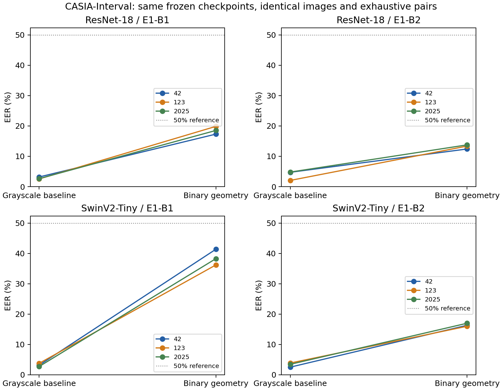
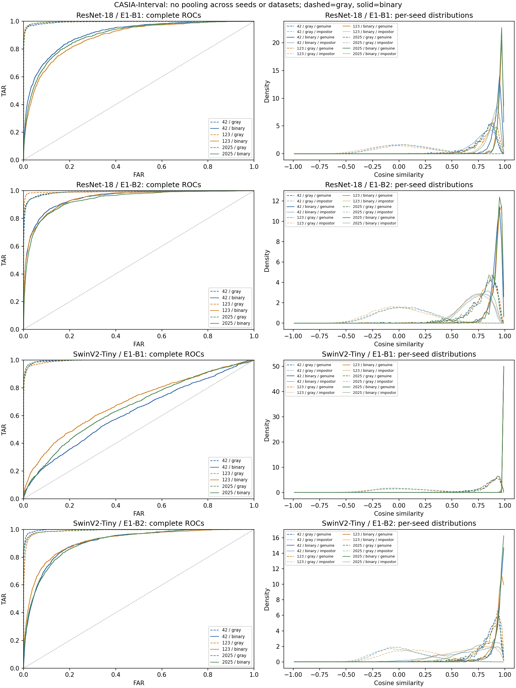

# CASIA-Interval: E2-G

## Absolute metrics

EER/TAR are percent, AUC [0,1]; mean ± sample SD over the three seeds.

| dataset | architecture | condition | variant | eer | roc_auc | tar_at_far_1pct | tar_at_far_0_1pct |
| --- | --- | --- | --- | --- | --- | --- | --- |
| CASIA-Interval | ResNet-18 | E1-B1 | binary_geometry | 18.5656 ± 1.2753 | 0.8967 ± 0.0118 | 27.9379 ± 4.9188 | 8.3518 ± 1.4101 |
| CASIA-Interval | ResNet-18 | E1-B1 | segmented_grayscale | 2.7820 ± 0.3462 | 0.9959 ± 0.0008 | 94.6046 ± 0.9665 | 83.7152 ± 2.0922 |
| CASIA-Interval | ResNet-18 | E1-B2 | binary_geometry | 13.1882 ± 0.6962 | 0.9426 ± 0.0059 | 46.4400 ± 5.0914 | 13.5009 ± 4.1293 |
| CASIA-Interval | ResNet-18 | E1-B2 | segmented_grayscale | 3.8632 ± 1.5662 | 0.9902 ± 0.0022 | 91.6482 ± 4.4976 | 76.0039 ± 10.2906 |
| CASIA-Interval | SwinV2-Tiny | E1-B1 | binary_geometry | 38.6302 ± 2.6040 | 0.6576 ± 0.0366 | 7.2185 ± 2.1792 | 2.1187 ± 1.1217 |
| CASIA-Interval | SwinV2-Tiny | E1-B1 | segmented_grayscale | 3.2307 ± 0.5268 | 0.9958 ± 0.0009 | 92.2148 ± 1.6664 | 80.0443 ± 2.8510 |
| CASIA-Interval | SwinV2-Tiny | E1-B2 | binary_geometry | 16.4492 ± 0.5081 | 0.9103 ± 0.0047 | 27.2727 ± 3.5160 | 7.9576 ± 3.2506 |
| CASIA-Interval | SwinV2-Tiny | E1-B2 | segmented_grayscale | 3.3017 ± 0.6931 | 0.9943 ± 0.0027 | 90.6874 ± 3.9505 | 72.2345 ± 11.6668 |

## Paired within-checkpoint differences

EER/TAR differences are percentage points; AUC differences are on [0,1].

| dataset | architecture | condition | variant | eer | roc_auc | tar_at_far_1pct | tar_at_far_0_1pct |
| --- | --- | --- | --- | --- | --- | --- | --- |
| CASIA-Interval | ResNet-18 | E1-B1 | binary-minus-grayscale | 15.7835 ± 1.5977 | -0.0992 ± 0.0125 | -66.6667 ± 5.5423 | -75.3634 ± 1.8244 |
| CASIA-Interval | ResNet-18 | E1-B2 | binary-minus-grayscale | 9.3250 ± 1.8443 | -0.0476 ± 0.0064 | -45.2082 ± 5.8600 | -62.5031 ± 12.8699 |
| CASIA-Interval | SwinV2-Tiny | E1-B1 | binary-minus-grayscale | 35.3995 ± 2.8947 | -0.3382 ± 0.0373 | -84.9963 ± 3.0750 | -77.9256 ± 3.9542 |
| CASIA-Interval | SwinV2-Tiny | E1-B2 | binary-minus-grayscale | 13.1475 ± 0.9030 | -0.0840 ± 0.0063 | -63.4146 ± 7.4513 | -64.2769 ± 13.5056 |

## All individual seeds

| architecture | condition | seed | variant | eer | roc_auc | tar_at_far_1pct | tar_at_far_0_1pct |
| --- | --- | --- | --- | --- | --- | --- | --- |
| ResNet-18 | E1-B1 | 42 | segmented_grayscale | 3.17812 | 0.99502 | 94.16112 | 84.84848 |
| ResNet-18 | E1-B1 | 42 | binary_geometry | 17.31321 | 0.90849 | 33.48115 | 9.97783 |
| ResNet-18 | E1-B1 | 123 | segmented_grayscale | 2.53746 | 0.99650 | 95.71323 | 84.99630 |
| ResNet-18 | E1-B1 | 123 | binary_geometry | 19.86263 | 0.88490 | 24.09460 | 7.61271 |
| ResNet-18 | E1-B1 | 2025 | segmented_grayscale | 2.63046 | 0.99609 | 93.93939 | 81.30081 |
| ResNet-18 | E1-B1 | 2025 | binary_geometry | 18.52083 | 0.89660 | 26.23799 | 7.46489 |
| ResNet-18 | E1-B2 | 42 | segmented_grayscale | 4.73023 | 0.98820 | 88.24834 | 64.81892 |
| ResNet-18 | E1-B2 | 42 | binary_geometry | 12.41685 | 0.94703 | 49.74132 | 17.14708 |
| ResNet-18 | E1-B2 | 123 | segmented_grayscale | 2.05521 | 0.99258 | 96.74797 | 85.07021 |
| ResNet-18 | E1-B2 | 123 | binary_geometry | 13.37768 | 0.94490 | 49.00222 | 14.33851 |
| ResNet-18 | E1-B2 | 2025 | segmented_grayscale | 4.80414 | 0.98990 | 89.94826 | 78.12269 |
| ResNet-18 | E1-B2 | 2025 | binary_geometry | 13.77006 | 0.93600 | 40.57650 | 9.01700 |
| SwinV2-Tiny | E1-B1 | 42 | segmented_grayscale | 3.17382 | 0.99632 | 90.61345 | 81.22690 |
| SwinV2-Tiny | E1-B1 | 42 | binary_geometry | 41.38950 | 0.61959 | 6.43016 | 1.92166 |
| SwinV2-Tiny | E1-B1 | 123 | segmented_grayscale | 3.78361 | 0.99484 | 92.09165 | 76.79231 |
| SwinV2-Tiny | E1-B1 | 123 | binary_geometry | 36.21582 | 0.69255 | 9.68219 | 3.32594 |
| SwinV2-Tiny | E1-B1 | 2025 | segmented_grayscale | 2.73466 | 0.99631 | 93.93939 | 82.11382 |
| SwinV2-Tiny | E1-B1 | 2025 | binary_geometry | 38.28529 | 0.66080 | 5.54324 | 1.10865 |
| SwinV2-Tiny | E1-B2 | 42 | segmented_grayscale | 2.53879 | 0.99737 | 94.30894 | 77.75314 |
| SwinV2-Tiny | E1-B2 | 42 | binary_geometry | 16.33407 | 0.90872 | 24.39024 | 4.21286 |
| SwinV2-Tiny | E1-B2 | 123 | segmented_grayscale | 3.89255 | 0.99238 | 86.47450 | 58.83222 |
| SwinV2-Tiny | E1-B2 | 123 | binary_geometry | 16.00861 | 0.91561 | 31.18995 | 10.05174 |
| SwinV2-Tiny | E1-B2 | 2025 | segmented_grayscale | 3.47376 | 0.99302 | 91.27864 | 80.11826 |
| SwinV2-Tiny | E1-B2 | 2025 | binary_geometry | 17.00500 | 0.90658 | 26.23799 | 9.60828 |

## Similarity-distribution changes

Values are binary minus grayscale, averaged within numerical seed, then mean/sample SD across seeds. Genuine mean and impostor p99/p99.9 distinguish score shifts from verification changes. Opposite-eye scores remain diagnostic.

| dataset | architecture | condition | pair_kind | mean_mean | mean_sample_sd | p99_mean | p99_sample_sd | p999_mean | p999_sample_sd |
| --- | --- | --- | --- | --- | --- | --- | --- | --- | --- |
| CASIA-Interval | ResNet-18 | E1-B1 | genuine | 0.135272 | 0.005796 | 0.029388 | 0.004251 | 0.01897 | 0.002338 |
| CASIA-Interval | ResNet-18 | E1-B1 | impostor | 0.819372 | 0.060761 | 0.374915 | 0.025483 | 0.261813 | 0.02468 |
| CASIA-Interval | ResNet-18 | E1-B1 | opposite_eye_diagnostic | 0.502997 | 0.064435 | 0.151605 | 0.037755 | 0.09734 | 0.022548 |
| CASIA-Interval | ResNet-18 | E1-B2 | genuine | 0.134219 | 0.010111 | 0.025612 | 0.00543 | 0.020937 | 0.004332 |
| CASIA-Interval | ResNet-18 | E1-B2 | impostor | 0.689283 | 0.027895 | 0.346933 | 0.04491 | 0.245494 | 0.048416 |
| CASIA-Interval | ResNet-18 | E1-B2 | opposite_eye_diagnostic | 0.382426 | 0.018305 | 0.167341 | 0.034552 | 0.123682 | 0.03178 |
| CASIA-Interval | SwinV2-Tiny | E1-B1 | genuine | 0.148571 | 0.006438 | 0.020021 | 0.002424 | 0.012551 | 0.001081 |
| CASIA-Interval | SwinV2-Tiny | E1-B1 | impostor | 0.949263 | 0.006862 | 0.348832 | 0.033511 | 0.215831 | 0.02386 |
| CASIA-Interval | SwinV2-Tiny | E1-B1 | opposite_eye_diagnostic | 0.435675 | 0.03993 | 0.089584 | 0.013382 | 0.056623 | 0.01156 |
| CASIA-Interval | SwinV2-Tiny | E1-B2 | genuine | 0.09403 | 0.029714 | 0.019953 | 0.00623 | 0.011612 | 0.004165 |
| CASIA-Interval | SwinV2-Tiny | E1-B2 | impostor | 0.611189 | 0.104578 | 0.308609 | 0.07465 | 0.192721 | 0.069619 |
| CASIA-Interval | SwinV2-Tiny | E1-B2 | opposite_eye_diagnostic | 0.135519 | 0.08055 | 0.065007 | 0.020832 | 0.05004 | 0.013015 |

## Subject influence

| dataset | architecture | condition | full_mean_eer_effect_pp | loo_min_effect_pp | loo_max_effect_pp | sign_reversals | most_influential_subject | largest_absolute_shift_pp |
| --- | --- | --- | --- | --- | --- | --- | --- | --- |
| CASIA-Interval | ResNet-18 | E1-B1 | 15.78354 | 14.43956 | 16.36972 | 0 | 125 | 1.34398 |
| CASIA-Interval | ResNet-18 | E1-B2 | 9.325 | 7.93302 | 9.75557 | 0 | 125 | 1.39198 |
| CASIA-Interval | SwinV2-Tiny | E1-B1 | 35.39951 | 34.67791 | 35.99034 | 0 | 125 | 0.7216 |
| CASIA-Interval | SwinV2-Tiny | E1-B2 | 13.14752 | 11.68969 | 13.75189 | 0 | 125 | 1.45783 |

Full per-image, subject-averaged and leave-one-subject-out values are in the corresponding CSV/Parquet tables. LOO removes all comparisons involving each omitted subject.

## Previews and figures

Biometric input contact sheets remain private; regenerate locally with the notebook.

