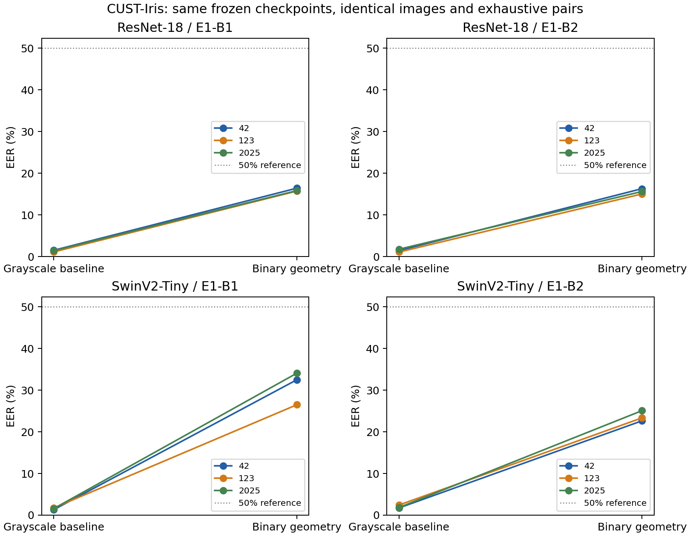
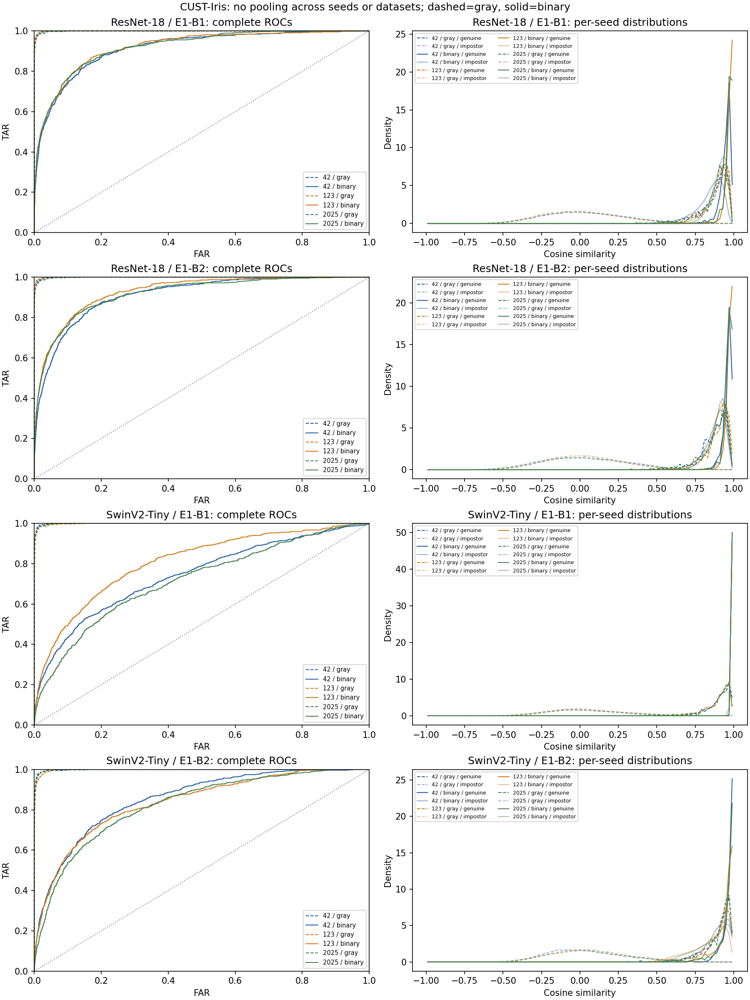

# CUST-Iris: E2-G

## Absolute metrics

EER/TAR are percent, AUC [0,1]; mean ± sample SD over the three seeds.

| dataset | architecture | condition | variant | eer | roc_auc | tar_at_far_1pct | tar_at_far_0_1pct |
| --- | --- | --- | --- | --- | --- | --- | --- |
| CUST-Iris | ResNet-18 | E1-B1 | binary_geometry | 15.9758 ± 0.3745 | 0.9180 ± 0.0030 | 39.1693 ± 2.9522 | 14.8791 ± 0.9242 |
| CUST-Iris | ResNet-18 | E1-B1 | segmented_grayscale | 1.3408 ± 0.2088 | 0.9992 ± 0.0003 | 98.2124 ± 0.6375 | 91.1672 ± 1.1041 |
| CUST-Iris | ResNet-18 | E1-B2 | binary_geometry | 15.6443 ± 0.6303 | 0.9195 ± 0.0084 | 36.6982 ± 3.4025 | 14.3533 ± 2.1912 |
| CUST-Iris | ResNet-18 | E1-B2 | segmented_grayscale | 1.4202 ± 0.3398 | 0.9991 ± 0.0004 | 97.8444 ± 0.7939 | 90.2734 ± 1.5799 |
| CUST-Iris | SwinV2-Tiny | E1-B1 | binary_geometry | 31.0200 ± 3.9944 | 0.7560 ± 0.0467 | 14.0904 ± 2.4503 | 3.9432 ± 1.9124 |
| CUST-Iris | SwinV2-Tiny | E1-B1 | segmented_grayscale | 1.5415 ± 0.2137 | 0.9987 ± 0.0004 | 97.4238 ± 0.5972 | 86.8034 ± 3.4061 |
| CUST-Iris | SwinV2-Tiny | E1-B2 | binary_geometry | 23.6877 ± 1.2551 | 0.8385 ± 0.0146 | 16.9295 ± 3.5175 | 5.0473 ± 1.7350 |
| CUST-Iris | SwinV2-Tiny | E1-B2 | segmented_grayscale | 2.0037 ± 0.3775 | 0.9983 ± 0.0004 | 96.3722 ± 1.5534 | 81.2303 ± 3.6957 |

## Paired within-checkpoint differences

EER/TAR differences are percentage points; AUC differences are on [0,1].

| dataset | architecture | condition | variant | eer | roc_auc | tar_at_far_1pct | tar_at_far_0_1pct |
| --- | --- | --- | --- | --- | --- | --- | --- |
| CUST-Iris | ResNet-18 | E1-B1 | binary-minus-grayscale | 14.6349 ± 0.2562 | -0.0813 ± 0.0031 | -59.0431 ± 2.5644 | -76.2881 ± 1.9972 |
| CUST-Iris | ResNet-18 | E1-B2 | binary-minus-grayscale | 14.2242 ± 0.5529 | -0.0796 ± 0.0082 | -61.1462 ± 3.4748 | -75.9201 ± 3.7635 |
| CUST-Iris | SwinV2-Tiny | E1-B1 | binary-minus-grayscale | 29.4785 ± 4.1358 | -0.2427 ± 0.0471 | -83.3333 ± 2.4452 | -82.8601 ± 5.2058 |
| CUST-Iris | SwinV2-Tiny | E1-B2 | binary-minus-grayscale | 21.6840 ± 1.3459 | -0.1598 ± 0.0145 | -79.4427 ± 3.9663 | -76.1830 ± 5.2289 |

## All individual seeds

| architecture | condition | seed | variant | eer | roc_auc | tar_at_far_1pct | tar_at_far_0_1pct |
| --- | --- | --- | --- | --- | --- | --- | --- |
| ResNet-18 | E1-B1 | 42 | segmented_grayscale | 1.49878 | 0.99932 | 97.63407 | 92.27129 |
| ResNet-18 | E1-B1 | 42 | binary_geometry | 16.40379 | 0.91452 | 35.80442 | 14.19558 |
| ResNet-18 | E1-B1 | 123 | segmented_grayscale | 1.10410 | 0.99947 | 98.89590 | 91.16719 |
| ResNet-18 | E1-B1 | 123 | binary_geometry | 15.70865 | 0.91951 | 40.37855 | 14.51104 |
| ResNet-18 | E1-B1 | 2025 | segmented_grayscale | 1.41956 | 0.99893 | 98.10726 | 90.06309 |
| ResNet-18 | E1-B1 | 2025 | binary_geometry | 15.81483 | 0.91985 | 41.32492 | 15.93060 |
| ResNet-18 | E1-B2 | 42 | segmented_grayscale | 1.42836 | 0.99914 | 97.94953 | 91.48265 |
| ResNet-18 | E1-B2 | 42 | binary_geometry | 16.28871 | 0.91188 | 32.80757 | 12.93375 |
| ResNet-18 | E1-B2 | 123 | segmented_grayscale | 1.07630 | 0.99945 | 98.58044 | 88.48580 |
| ResNet-18 | E1-B2 | 123 | binary_geometry | 15.02911 | 0.92850 | 39.11672 | 16.87697 |
| ResNet-18 | E1-B2 | 2025 | segmented_grayscale | 1.75584 | 0.99868 | 97.00315 | 90.85174 |
| ResNet-18 | E1-B2 | 2025 | binary_geometry | 15.61514 | 0.91812 | 38.17035 | 13.24921 |
| SwinV2-Tiny | E1-B1 | 42 | segmented_grayscale | 1.31213 | 0.99892 | 98.10726 | 86.43533 |
| SwinV2-Tiny | E1-B1 | 42 | binary_geometry | 32.49211 | 0.74293 | 14.82650 | 5.04732 |
| SwinV2-Tiny | E1-B1 | 123 | segmented_grayscale | 1.73502 | 0.99828 | 97.00315 | 83.59621 |
| SwinV2-Tiny | E1-B1 | 123 | binary_geometry | 26.49842 | 0.80787 | 16.08833 | 5.04732 |
| SwinV2-Tiny | E1-B1 | 2025 | segmented_grayscale | 1.57729 | 0.99892 | 97.16088 | 90.37855 |
| SwinV2-Tiny | E1-B1 | 2025 | binary_geometry | 34.06940 | 0.71717 | 11.35647 | 1.73502 |
| SwinV2-Tiny | E1-B2 | 42 | segmented_grayscale | 1.73502 | 0.99862 | 97.63407 | 83.59621 |
| SwinV2-Tiny | E1-B2 | 42 | binary_geometry | 22.64035 | 0.85394 | 19.55836 | 5.04732 |
| SwinV2-Tiny | E1-B2 | 123 | segmented_grayscale | 2.43537 | 0.99781 | 94.63722 | 76.97161 |
| SwinV2-Tiny | E1-B2 | 123 | binary_geometry | 23.34385 | 0.83671 | 18.29653 | 6.78233 |
| SwinV2-Tiny | E1-B2 | 2025 | segmented_grayscale | 1.84078 | 0.99847 | 96.84543 | 83.12303 |
| SwinV2-Tiny | E1-B2 | 2025 | binary_geometry | 25.07886 | 0.82482 | 12.93375 | 3.31230 |

## Similarity-distribution changes

Values are binary minus grayscale, averaged within numerical seed, then mean/sample SD across seeds. Genuine mean and impostor p99/p99.9 distinguish score shifts from verification changes. Opposite-eye scores remain diagnostic.

| dataset | architecture | condition | pair_kind | mean_mean | mean_sample_sd | p99_mean | p99_sample_sd | p999_mean | p999_sample_sd |
| --- | --- | --- | --- | --- | --- | --- | --- | --- | --- |
| CUST-Iris | ResNet-18 | E1-B1 | genuine | 0.082982 | 0.010213 | 0.01214 | 0.001363 | 0.008517 | 0.001386 |
| CUST-Iris | ResNet-18 | E1-B1 | impostor | 0.861597 | 0.037829 | 0.363379 | 0.008933 | 0.238858 | 0.013181 |
| CUST-Iris | ResNet-18 | E1-B1 | opposite_eye_diagnostic | 0.439648 | 0.044903 | 0.109605 | 0.036212 | 0.082909 | 0.019987 |
| CUST-Iris | ResNet-18 | E1-B2 | genuine | 0.087399 | 0.004396 | 0.012208 | 0.003629 | 0.007809 | 0.001504 |
| CUST-Iris | ResNet-18 | E1-B2 | impostor | 0.861022 | 0.01068 | 0.360471 | 0.024601 | 0.22582 | 0.014876 |
| CUST-Iris | ResNet-18 | E1-B2 | opposite_eye_diagnostic | 0.423157 | 0.010865 | 0.117348 | 0.030954 | 0.096849 | 0.025764 |
| CUST-Iris | SwinV2-Tiny | E1-B1 | genuine | 0.099697 | 0.003837 | 0.010579 | 0.002924 | 0.006914 | 0.003252 |
| CUST-Iris | SwinV2-Tiny | E1-B1 | impostor | 0.947279 | 0.013564 | 0.342716 | 0.02536 | 0.18896 | 0.023669 |
| CUST-Iris | SwinV2-Tiny | E1-B1 | opposite_eye_diagnostic | 0.449967 | 0.03762 | 0.08111 | 0.041321 | 0.061405 | 0.030368 |
| CUST-Iris | SwinV2-Tiny | E1-B2 | genuine | 0.062295 | 0.009053 | 0.00747 | 0.001038 | 0.004285 | 0.001308 |
| CUST-Iris | SwinV2-Tiny | E1-B2 | impostor | 0.799445 | 0.040511 | 0.313941 | 0.014228 | 0.167598 | 0.016403 |
| CUST-Iris | SwinV2-Tiny | E1-B2 | opposite_eye_diagnostic | 0.338061 | 0.043386 | 0.058863 | 0.020153 | 0.04243 | 0.015425 |

## Subject influence

| dataset | architecture | condition | full_mean_eer_effect_pp | loo_min_effect_pp | loo_max_effect_pp | sign_reversals | most_influential_subject | largest_absolute_shift_pp |
| --- | --- | --- | --- | --- | --- | --- | --- | --- |
| CUST-Iris | ResNet-18 | E1-B1 | 14.63494 | 14.26987 | 15.03423 | 0 | 286 | 0.39928 |
| CUST-Iris | ResNet-18 | E1-B2 | 14.22416 | 13.82762 | 14.63212 | 0 | 226 | 0.40797 |
| CUST-Iris | SwinV2-Tiny | E1-B1 | 29.4785 | 29.15253 | 29.87202 | 0 | 334 | 0.39352 |
| CUST-Iris | SwinV2-Tiny | E1-B2 | 21.68397 | 21.36709 | 22.30609 | 0 | 279 | 0.62212 |

Full per-image, subject-averaged and leave-one-subject-out values are in the corresponding CSV/Parquet tables. LOO removes all comparisons involving each omitted subject.

## Previews and figures

Biometric input contact sheets remain private; regenerate locally with the notebook.

