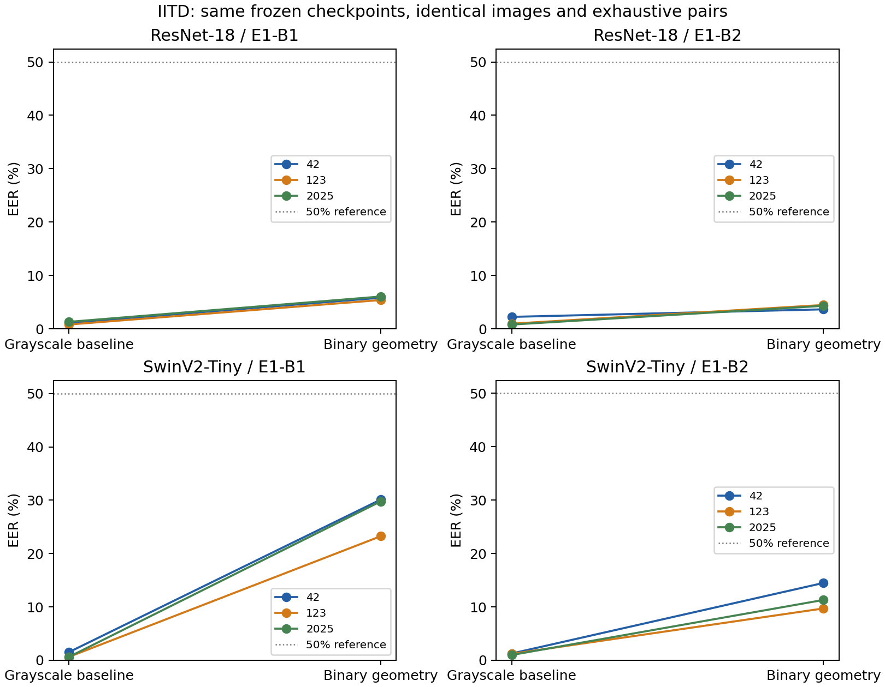
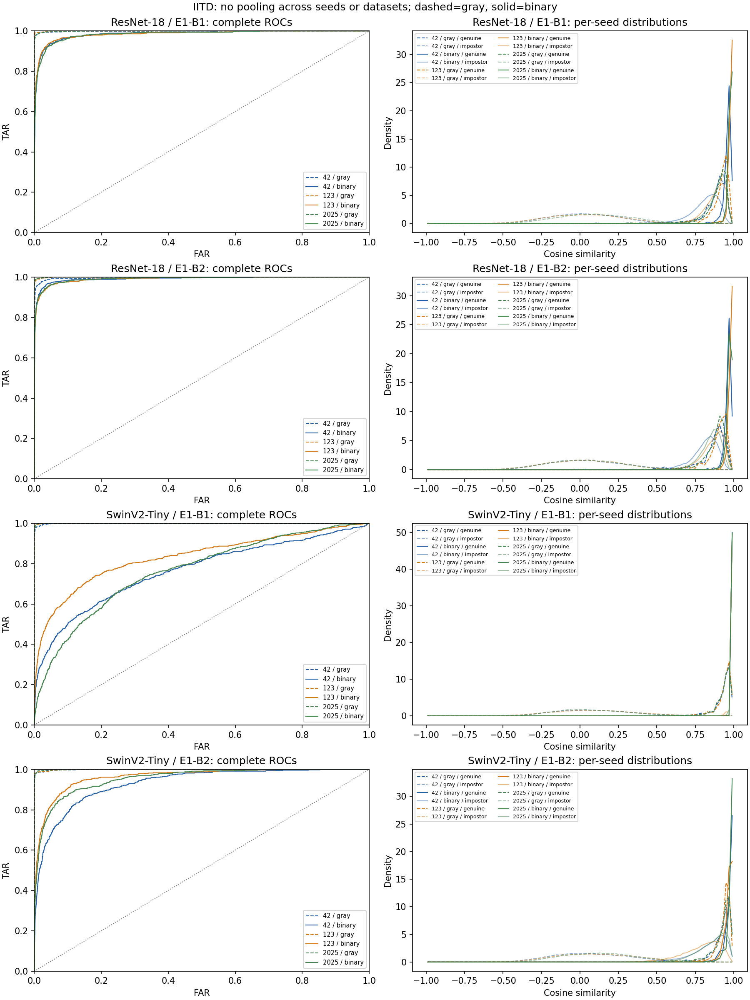

# IITD: E2-G

## Absolute metrics

EER/TAR are percent, AUC [0,1]; mean ± sample SD over the three seeds.

| dataset | architecture | condition | variant | eer | roc_auc | tar_at_far_1pct | tar_at_far_0_1pct |
| --- | --- | --- | --- | --- | --- | --- | --- |
| IITD | ResNet-18 | E1-B1 | binary_geometry | 5.7479 ± 0.3324 | 0.9844 ± 0.0007 | 79.6709 ± 0.9598 | 50.3715 ± 3.9468 |
| IITD | ResNet-18 | E1-B1 | segmented_grayscale | 1.0694 ± 0.2537 | 0.9993 ± 0.0004 | 98.8854 ± 0.3185 | 97.0276 ± 1.4795 |
| IITD | ResNet-18 | E1-B2 | binary_geometry | 4.1341 ± 0.4316 | 0.9913 ± 0.0003 | 88.3758 ± 0.5741 | 65.3397 ± 4.4652 |
| IITD | ResNet-18 | E1-B2 | segmented_grayscale | 1.3243 ± 0.7882 | 0.9986 ± 0.0019 | 98.1423 ± 1.8456 | 93.6306 ± 6.2102 |
| IITD | SwinV2-Tiny | E1-B1 | binary_geometry | 27.7130 ± 3.8701 | 0.7875 ± 0.0398 | 23.5138 ± 9.5824 | 7.8025 ± 4.2220 |
| IITD | SwinV2-Tiny | E1-B1 | segmented_grayscale | 0.9340 ± 0.5146 | 0.9997 ± 0.0002 | 99.2569 ± 0.7525 | 96.8684 ± 1.2969 |
| IITD | SwinV2-Tiny | E1-B2 | binary_geometry | 11.8365 ± 2.4324 | 0.9501 ± 0.0170 | 51.1146 ± 7.7291 | 22.5584 ± 6.1781 |
| IITD | SwinV2-Tiny | E1-B2 | segmented_grayscale | 1.1590 ± 0.1443 | 0.9993 ± 0.0001 | 98.7261 ± 0.2758 | 96.1253 ± 0.8770 |

## Paired within-checkpoint differences

EER/TAR differences are percentage points; AUC differences are on [0,1].

| dataset | architecture | condition | variant | eer | roc_auc | tar_at_far_1pct | tar_at_far_0_1pct |
| --- | --- | --- | --- | --- | --- | --- | --- |
| IITD | ResNet-18 | E1-B1 | binary-minus-grayscale | 4.6785 ± 0.0788 | -0.0148 ± 0.0010 | -19.2144 ± 0.6435 | -46.6561 ± 2.7210 |
| IITD | ResNet-18 | E1-B2 | binary-minus-grayscale | 2.8098 ± 1.2080 | -0.0073 ± 0.0021 | -9.7665 ± 2.0163 | -28.2909 ± 3.9307 |
| IITD | SwinV2-Tiny | E1-B1 | binary-minus-grayscale | 26.7790 ± 3.6198 | -0.2122 ± 0.0397 | -75.7431 ± 9.8241 | -89.0658 ± 4.6050 |
| IITD | SwinV2-Tiny | E1-B2 | binary-minus-grayscale | 10.6775 ± 2.3762 | -0.0492 ± 0.0169 | -47.6115 ± 7.6648 | -73.5669 ± 6.3515 |

## All individual seeds

| architecture | condition | seed | variant | eer | roc_auc | tar_at_far_1pct | tar_at_far_0_1pct |
| --- | --- | --- | --- | --- | --- | --- | --- |
| ResNet-18 | E1-B1 | 42 | segmented_grayscale | 1.11465 | 0.99883 | 98.88535 | 96.33758 |
| ResNet-18 | E1-B1 | 42 | binary_geometry | 5.81243 | 0.98512 | 79.77707 | 46.81529 |
| ResNet-18 | E1-B1 | 123 | segmented_grayscale | 0.79618 | 0.99963 | 99.20382 | 98.72611 |
| ResNet-18 | E1-B1 | 123 | binary_geometry | 5.38793 | 0.98446 | 80.57325 | 54.61783 |
| ResNet-18 | E1-B1 | 2025 | segmented_grayscale | 1.29746 | 0.99932 | 98.56688 | 96.01911 |
| ResNet-18 | E1-B1 | 2025 | binary_geometry | 6.04330 | 0.98369 | 78.66242 | 49.68153 |
| ResNet-18 | E1-B2 | 42 | segmented_grayscale | 2.22930 | 0.99632 | 96.01911 | 86.46497 |
| ResNet-18 | E1-B2 | 42 | binary_geometry | 3.64420 | 0.99143 | 88.53503 | 61.46497 |
| ResNet-18 | E1-B2 | 123 | segmented_grayscale | 0.95541 | 0.99963 | 99.04459 | 96.97452 |
| ResNet-18 | E1-B2 | 123 | binary_geometry | 4.45860 | 0.99088 | 87.73885 | 64.33121 |
| ResNet-18 | E1-B2 | 2025 | segmented_grayscale | 0.78805 | 0.99973 | 99.36306 | 97.45223 |
| ResNet-18 | E1-B2 | 2025 | binary_geometry | 4.29936 | 0.99144 | 88.85350 | 70.22293 |
| SwinV2-Tiny | E1-B1 | 42 | segmented_grayscale | 1.52821 | 0.99945 | 98.40764 | 95.38217 |
| SwinV2-Tiny | E1-B1 | 42 | binary_geometry | 30.11364 | 0.76487 | 24.36306 | 7.96178 |
| SwinV2-Tiny | E1-B1 | 123 | segmented_grayscale | 0.63694 | 0.99983 | 99.52229 | 97.45223 |
| SwinV2-Tiny | E1-B1 | 123 | binary_geometry | 23.24841 | 0.83349 | 32.64331 | 11.94268 |
| SwinV2-Tiny | E1-B1 | 2025 | segmented_grayscale | 0.63694 | 0.99989 | 99.84076 | 97.77070 |
| SwinV2-Tiny | E1-B1 | 2025 | binary_geometry | 29.77707 | 0.76415 | 13.53503 | 3.50318 |
| SwinV2-Tiny | E1-B2 | 42 | segmented_grayscale | 1.27389 | 0.99921 | 98.56688 | 96.17834 |
| SwinV2-Tiny | E1-B2 | 42 | binary_geometry | 14.49045 | 0.93121 | 42.51592 | 15.44586 |
| SwinV2-Tiny | E1-B2 | 123 | segmented_grayscale | 1.20603 | 0.99933 | 98.56688 | 96.97452 |
| SwinV2-Tiny | E1-B2 | 123 | binary_geometry | 9.71338 | 0.96412 | 57.48408 | 25.63694 |
| SwinV2-Tiny | E1-B2 | 2025 | segmented_grayscale | 0.99704 | 0.99946 | 99.04459 | 95.22293 |
| SwinV2-Tiny | E1-B2 | 2025 | binary_geometry | 11.30573 | 0.95497 | 53.34395 | 26.59236 |

## Similarity-distribution changes

Values are binary minus grayscale, averaged within numerical seed, then mean/sample SD across seeds. Genuine mean and impostor p99/p99.9 distinguish score shifts from verification changes. Opposite-eye scores remain diagnostic.

| dataset | architecture | condition | pair_kind | mean_mean | mean_sample_sd | p99_mean | p99_sample_sd | p999_mean | p999_sample_sd |
| --- | --- | --- | --- | --- | --- | --- | --- | --- | --- |
| IITD | ResNet-18 | E1-B1 | genuine | 0.082027 | 0.010396 | 0.020783 | 0.003465 | 0.01525 | 0.003254 |
| IITD | ResNet-18 | E1-B1 | impostor | 0.811445 | 0.032152 | 0.40546 | 0.037442 | 0.29429 | 0.034509 |
| IITD | ResNet-18 | E1-B1 | opposite_eye_diagnostic | 0.437873 | 0.039842 | 0.172472 | 0.018881 | 0.160591 | 0.017862 |
| IITD | ResNet-18 | E1-B2 | genuine | 0.094615 | 0.006755 | 0.021378 | 0.00507 | 0.014035 | 0.003614 |
| IITD | ResNet-18 | E1-B2 | impostor | 0.809698 | 0.034217 | 0.391373 | 0.048114 | 0.265512 | 0.072829 |
| IITD | ResNet-18 | E1-B2 | opposite_eye_diagnostic | 0.420566 | 0.024117 | 0.171152 | 0.007424 | 0.134157 | 0.017307 |
| IITD | SwinV2-Tiny | E1-B1 | genuine | 0.064565 | 0.004745 | 0.009677 | 0.001569 | 0.007226 | 0.001017 |
| IITD | SwinV2-Tiny | E1-B1 | impostor | 0.908275 | 0.00705 | 0.342844 | 0.024897 | 0.220778 | 0.015515 |
| IITD | SwinV2-Tiny | E1-B1 | opposite_eye_diagnostic | 0.412585 | 0.030448 | 0.145336 | 0.020787 | 0.111988 | 0.024617 |
| IITD | SwinV2-Tiny | E1-B2 | genuine | 0.045087 | 0.009804 | 0.007717 | 0.000349 | 0.005563 | 0.000718 |
| IITD | SwinV2-Tiny | E1-B2 | impostor | 0.728015 | 0.038429 | 0.326674 | 0.016212 | 0.217628 | 0.009146 |
| IITD | SwinV2-Tiny | E1-B2 | opposite_eye_diagnostic | 0.286915 | 0.026489 | 0.090904 | 0.025496 | 0.074823 | 0.02509 |

## Subject influence

| dataset | architecture | condition | full_mean_eer_effect_pp | loo_min_effect_pp | loo_max_effect_pp | sign_reversals | most_influential_subject | largest_absolute_shift_pp |
| --- | --- | --- | --- | --- | --- | --- | --- | --- |
| IITD | ResNet-18 | E1-B1 | 4.67846 | 4.29938 | 4.92534 | 0 | 214 | 0.37908 |
| IITD | ResNet-18 | E1-B2 | 2.8098 | 2.502 | 3.11312 | 0 | 064 | 0.3078 |
| IITD | SwinV2-Tiny | E1-B1 | 26.77901 | 26.08611 | 27.19648 | 0 | 214 | 0.6929 |
| IITD | SwinV2-Tiny | E1-B2 | 10.67753 | 10.2147 | 11.04711 | 0 | 033 | 0.46284 |

Full per-image, subject-averaged and leave-one-subject-out values are in the corresponding CSV/Parquet tables. LOO removes all comparisons involving each omitted subject.

## Previews and figures

Biometric input contact sheets remain private; regenerate locally with the notebook.

