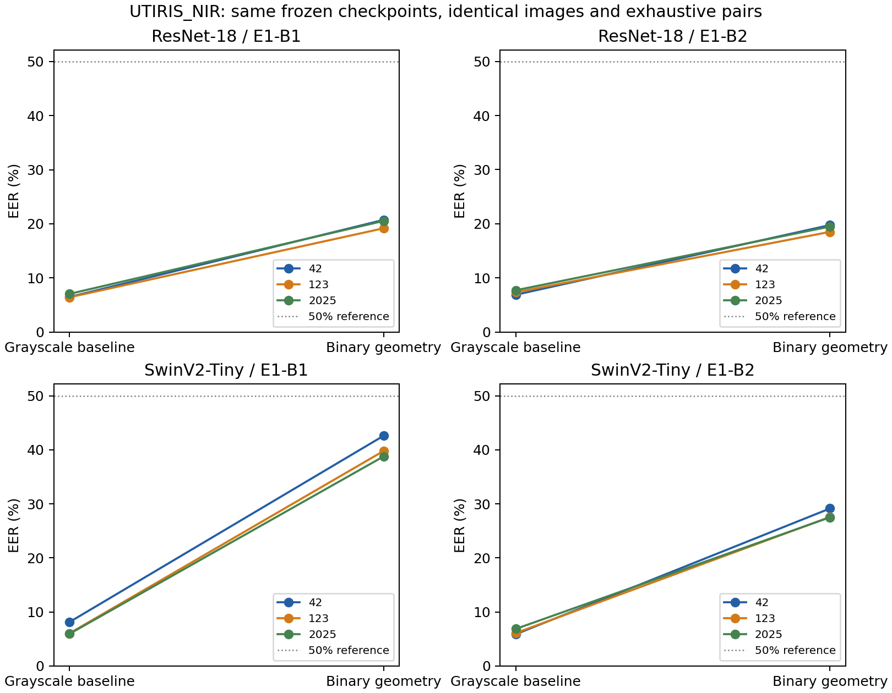
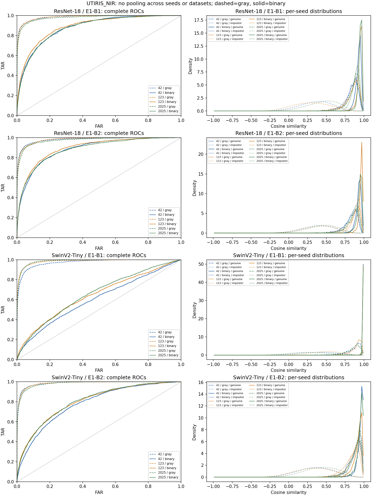

# UTIRIS_NIR: E2-G

## Absolute metrics

EER/TAR are percent, AUC [0,1]; mean ± sample SD over the three seeds.

| dataset | architecture | condition | variant | eer | roc_auc | tar_at_far_1pct | tar_at_far_0_1pct |
| --- | --- | --- | --- | --- | --- | --- | --- |
| UTIRIS_NIR | ResNet-18 | E1-B1 | binary_geometry | 20.1425 ± 0.8469 | 0.8820 ± 0.0061 | 22.0855 ± 2.2668 | 5.9154 ± 0.8841 |
| UTIRIS_NIR | ResNet-18 | E1-B1 | segmented_grayscale | 6.6357 ± 0.3494 | 0.9836 ± 0.0036 | 80.0302 ± 2.4793 | 56.4983 ± 3.7966 |
| UTIRIS_NIR | ResNet-18 | E1-B2 | binary_geometry | 19.2439 ± 0.6595 | 0.8875 ± 0.0065 | 24.9568 ± 0.7507 | 7.6857 ± 0.4312 |
| UTIRIS_NIR | ResNet-18 | E1-B2 | segmented_grayscale | 7.3034 ± 0.4180 | 0.9791 ± 0.0039 | 75.3670 ± 3.3217 | 51.7487 ± 3.6159 |
| UTIRIS_NIR | SwinV2-Tiny | E1-B1 | binary_geometry | 40.4043 ± 1.9808 | 0.6335 ± 0.0257 | 5.0734 ± 1.0369 | 0.9067 ± 0.5301 |
| UTIRIS_NIR | SwinV2-Tiny | E1-B1 | segmented_grayscale | 6.7172 ± 1.2329 | 0.9815 ± 0.0069 | 74.6114 ± 4.7611 | 46.7185 ± 9.0535 |
| UTIRIS_NIR | SwinV2-Tiny | E1-B2 | binary_geometry | 28.0916 ± 0.9243 | 0.7949 ± 0.0126 | 12.1762 ± 2.1559 | 2.8929 ± 0.9075 |
| UTIRIS_NIR | SwinV2-Tiny | E1-B2 | segmented_grayscale | 6.2924 ± 0.5181 | 0.9848 ± 0.0016 | 76.2090 ± 1.7551 | 47.9706 ± 2.8887 |

## Paired within-checkpoint differences

EER/TAR differences are percentage points; AUC differences are on [0,1].

| dataset | architecture | condition | variant | eer | roc_auc | tar_at_far_1pct | tar_at_far_0_1pct |
| --- | --- | --- | --- | --- | --- | --- | --- |
| UTIRIS_NIR | ResNet-18 | E1-B1 | binary-minus-grayscale | 13.5068 ± 0.7501 | -0.1016 ± 0.0043 | -57.9447 ± 2.1288 | -50.5829 ± 3.4345 |
| UTIRIS_NIR | ResNet-18 | E1-B2 | binary-minus-grayscale | 11.9405 ± 0.8688 | -0.0916 ± 0.0046 | -50.4102 ± 4.0449 | -44.0630 ± 4.0016 |
| UTIRIS_NIR | SwinV2-Tiny | E1-B1 | binary-minus-grayscale | 33.6871 ± 0.8217 | -0.3480 ± 0.0188 | -69.5380 ± 4.4920 | -45.8117 ± 8.7270 |
| UTIRIS_NIR | SwinV2-Tiny | E1-B2 | binary-minus-grayscale | 21.7992 ± 1.3362 | -0.1899 ± 0.0140 | -64.0328 ± 3.7444 | -45.0777 ± 3.7648 |

## All individual seeds

| architecture | condition | seed | variant | eer | roc_auc | tar_at_far_1pct | tar_at_far_0_1pct |
| --- | --- | --- | --- | --- | --- | --- | --- |
| ResNet-18 | E1-B1 | 42 | segmented_grayscale | 6.46178 | 0.98572 | 82.31865 | 59.06736 |
| ResNet-18 | E1-B1 | 42 | binary_geometry | 20.72539 | 0.88051 | 22.08549 | 5.50518 |
| ResNet-18 | E1-B1 | 123 | segmented_grayscale | 6.40744 | 0.98568 | 80.37565 | 58.29016 |
| ResNet-18 | E1-B1 | 123 | binary_geometry | 19.17098 | 0.88882 | 24.35233 | 6.93005 |
| ResNet-18 | E1-B1 | 2025 | segmented_grayscale | 7.03796 | 0.97954 | 77.39637 | 52.13731 |
| ResNet-18 | E1-B1 | 2025 | binary_geometry | 20.53109 | 0.87682 | 19.81865 | 5.31088 |
| ResNet-18 | E1-B2 | 42 | segmented_grayscale | 6.87256 | 0.98105 | 78.30311 | 55.56995 |
| ResNet-18 | E1-B2 | 42 | binary_geometry | 19.75389 | 0.88505 | 24.15803 | 7.18912 |
| ResNet-18 | E1-B2 | 123 | segmented_grayscale | 7.33050 | 0.98164 | 76.03627 | 51.29534 |
| ResNet-18 | E1-B2 | 123 | binary_geometry | 18.49918 | 0.89479 | 25.06477 | 7.96632 |
| ResNet-18 | E1-B2 | 2025 | segmented_grayscale | 7.70725 | 0.97457 | 71.76166 | 48.38083 |
| ResNet-18 | E1-B2 | 2025 | binary_geometry | 19.47863 | 0.88251 | 25.64767 | 7.90155 |
| SwinV2-Tiny | E1-B1 | 42 | segmented_grayscale | 8.13976 | 0.97356 | 69.55959 | 40.22021 |
| SwinV2-Tiny | E1-B1 | 42 | binary_geometry | 42.61658 | 0.60450 | 5.11658 | 1.03627 |
| SwinV2-Tiny | E1-B1 | 123 | segmented_grayscale | 6.05339 | 0.98466 | 79.01554 | 57.05959 |
| SwinV2-Tiny | E1-B1 | 123 | binary_geometry | 39.80102 | 0.64232 | 6.08808 | 1.36010 |
| SwinV2-Tiny | E1-B1 | 2025 | segmented_grayscale | 5.95855 | 0.98635 | 75.25907 | 42.87565 |
| SwinV2-Tiny | E1-B1 | 2025 | binary_geometry | 38.79534 | 0.65367 | 4.01554 | 0.32383 |
| SwinV2-Tiny | E1-B2 | 42 | segmented_grayscale | 5.89379 | 0.98622 | 78.04404 | 50.12953 |
| SwinV2-Tiny | E1-B2 | 42 | binary_geometry | 29.15824 | 0.78039 | 9.71503 | 2.00777 |
| SwinV2-Tiny | E1-B2 | 123 | segmented_grayscale | 6.10533 | 0.98503 | 76.03627 | 44.68912 |
| SwinV2-Tiny | E1-B2 | 123 | binary_geometry | 27.59067 | 0.80109 | 13.73057 | 3.82124 |
| SwinV2-Tiny | E1-B2 | 2025 | segmented_grayscale | 6.87803 | 0.98303 | 74.54663 | 49.09326 |
| SwinV2-Tiny | E1-B2 | 2025 | binary_geometry | 27.52591 | 0.80313 | 13.08290 | 2.84974 |

## Similarity-distribution changes

Values are binary minus grayscale, averaged within numerical seed, then mean/sample SD across seeds. Genuine mean and impostor p99/p99.9 distinguish score shifts from verification changes. Opposite-eye scores remain diagnostic.

| dataset | architecture | condition | pair_kind | mean_mean | mean_sample_sd | p99_mean | p99_sample_sd | p999_mean | p999_sample_sd |
| --- | --- | --- | --- | --- | --- | --- | --- | --- | --- |
| UTIRIS_NIR | ResNet-18 | E1-B1 | genuine | 0.097068 | 0.008765 | 0.015932 | 0.002195 | 0.008433 | 0.003117 |
| UTIRIS_NIR | ResNet-18 | E1-B1 | impostor | 0.493473 | 0.063198 | 0.179006 | 0.024441 | 0.121435 | 0.016536 |
| UTIRIS_NIR | ResNet-18 | E1-B1 | opposite_eye_diagnostic | 0.234457 | 0.023772 | 0.06591 | 0.004296 | 0.037214 | 0.006763 |
| UTIRIS_NIR | ResNet-18 | E1-B2 | genuine | 0.099801 | 0.004666 | 0.020072 | 0.004241 | 0.012542 | 0.002361 |
| UTIRIS_NIR | ResNet-18 | E1-B2 | impostor | 0.455321 | 0.034468 | 0.165442 | 0.019999 | 0.113181 | 0.01823 |
| UTIRIS_NIR | ResNet-18 | E1-B2 | opposite_eye_diagnostic | 0.213735 | 0.010922 | 0.072003 | 0.009882 | 0.050903 | 0.013059 |
| UTIRIS_NIR | SwinV2-Tiny | E1-B1 | genuine | 0.128584 | 0.025322 | 0.01829 | 0.001586 | 0.010289 | 0.001784 |
| UTIRIS_NIR | SwinV2-Tiny | E1-B1 | impostor | 0.617776 | 0.099642 | 0.169745 | 0.029093 | 0.097098 | 0.011615 |
| UTIRIS_NIR | SwinV2-Tiny | E1-B1 | opposite_eye_diagnostic | 0.249612 | 0.044016 | 0.051542 | 0.00528 | 0.033198 | 0.004023 |
| UTIRIS_NIR | SwinV2-Tiny | E1-B2 | genuine | 0.069229 | 0.016547 | 0.011421 | 0.00265 | 0.007898 | 0.002684 |
| UTIRIS_NIR | SwinV2-Tiny | E1-B2 | impostor | 0.501323 | 0.048578 | 0.156096 | 0.022748 | 0.092134 | 0.012987 |
| UTIRIS_NIR | SwinV2-Tiny | E1-B2 | opposite_eye_diagnostic | 0.151117 | 0.031427 | 0.036805 | 0.005866 | 0.025701 | 0.007527 |

## Subject influence

| dataset | architecture | condition | full_mean_eer_effect_pp | loo_min_effect_pp | loo_max_effect_pp | sign_reversals | most_influential_subject | largest_absolute_shift_pp |
| --- | --- | --- | --- | --- | --- | --- | --- | --- |
| UTIRIS_NIR | ResNet-18 | E1-B1 | 13.50676 | 13.20059 | 13.77681 | 0 | 061 | 0.30617 |
| UTIRIS_NIR | ResNet-18 | E1-B2 | 11.94046 | 11.69993 | 12.22912 | 0 | 077 | 0.28866 |
| UTIRIS_NIR | SwinV2-Tiny | E1-B1 | 33.68708 | 33.48199 | 33.96803 | 0 | 061 | 0.28095 |
| UTIRIS_NIR | SwinV2-Tiny | E1-B2 | 21.79922 | 21.58424 | 22.07107 | 0 | 068 | 0.27184 |

Full per-image, subject-averaged and leave-one-subject-out values are in the corresponding CSV/Parquet tables. LOO removes all comparisons involving each omitted subject.

## Previews and figures

Biometric input contact sheets remain private; regenerate locally with the notebook.

